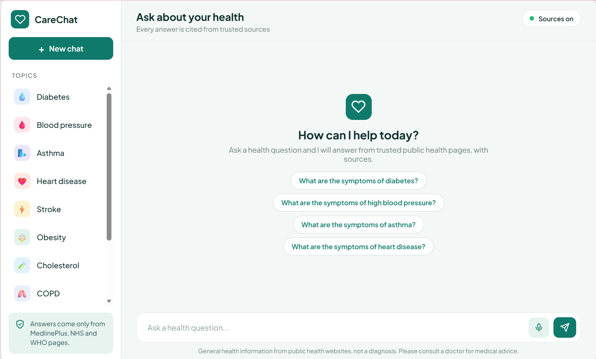
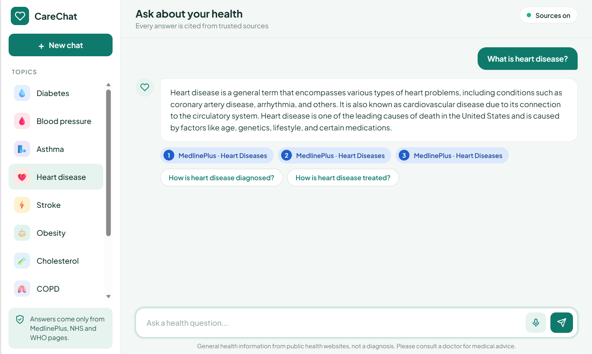
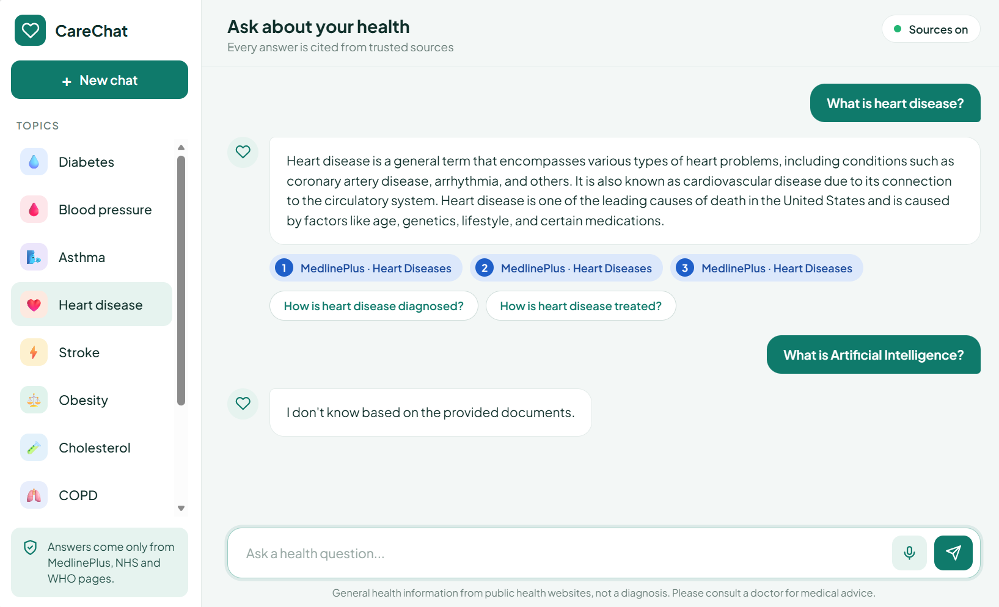

# 🩺 CareChat – Medical RAG Chatbot

<p align="center">
  
  
  
  
</p>

<p align="center">
  <b>An AI-powered health information chatbot that answers using trusted public health sources.</b>
  <br />
  Built with Hybrid Retrieval-Augmented Generation, Reranking, and Source Citations.
</p>

<p align="center">
  <a href="PASTE_VIDEO_LINK_HERE">▶️ Watch Demo</a> •
  <a href="#-features">Features</a> •
  <a href="#-system-architecture">Architecture</a> •
  <a href="#-installation">Installation</a>
</p>

---

## 📌 About the Project

**CareChat** is an educational medical question-answering chatbot developed as a student project.

It uses Retrieval-Augmented Generation (RAG) to answer general health questions using information retrieved from trusted public health websites:

- 🏥 [MedlinePlus](https://medlineplus.gov/)
- 🌍 [World Health Organization (WHO)](https://www.who.int/)
- 🩺 [National Health Service (NHS)](https://www.nhs.uk/)

Unlike a general chatbot, CareChat is designed to generate answers from retrieved documents, provide source citations, and refuse questions when the available information does not support an answer.

> ⚠️ **Important:** CareChat is an educational project, not a medical advice, diagnosis, or treatment tool.

---

## 📸 Application Preview

<p align="center">
  
</p>

<p align="center">
  <i>CareChat main chat interface</i>
</p>

<details>
  <summary>🖼️ View More Screenshots</summary>

  ### 💬 Chat Interface
  

  ### 📚 Answers with Sources
  

</details>

---

## 🎬 Project Demo

<p align="center">
  <a href="PASTE_VIDEO_LINK_HERE">
    
  </a>
</p>

Replace the demo link with your uploaded project video.

---

## ✨ Features

| Icon | Feature | Description |
|---|---|---|
| 🧠 | RAG Architecture | Generates answers using retrieved health documents |
| 🔎 | Hybrid Search | Combines dense vector search and BM25 |
| ⚡ | FAISS | Performs semantic vector retrieval |
| 🔤 | BM25 | Finds relevant passages using keywords |
| 🔄 | RRF | Combines multiple retrieval rankings |
| 🎯 | Reranking | Uses a cross-encoder to improve relevance |
| 📖 | Source Citations | Provides references such as `[1]` |
| 🛑 | Refusal System | Refuses unsupported questions |
| 🚨 | Emergency Warning | Detects selected emergency keywords |
| ⚖️ | Disclaimer | Adds a medical disclaimer to every answer |
| 🎤 | Voice Input | Supports voice input through the interface |
| 💬 | Follow-up Questions | Offers suggested follow-up questions |

---

## 🏗️ System Architecture

CareChat follows a Hybrid RAG pipeline.

```text
             👤 User Question
                    |
                    ▼
             🔍 Query Processing
                    |
                    ▼
              Hybrid Retrieval
              /             \
             ▼               ▼
        FAISS Search      BM25 Search
             \               /
              \             /
                    ▼
           🔄 Reciprocal Rank Fusion
                    |
                    ▼
             🎯 Cross-Encoder
                Reranking
                    |
                    ▼
               🛑 Refusal Check
                    |
             ┌──────┴──────┐
             ▼             ▼
          Refuse       Use Retrieved
          Answer         Passages
                            |
                            ▼
                      🤖 Qwen2.5
                            |
                            ▼
                    📝 Answer Generation
                            |
                            ▼
                    📚 Source Citations
                            |
                            ▼
                    ⚖️ Safety Disclaimer
                            |
                            ▼
                       Final Answer
```

### 🔧 Technology Stack

| Component | Technology |
|---|---|
| Embedding Model | BAAI/bge-small-en-v1.5 |
| Vector Search | FAISS |
| Keyword Search | BM25 |
| Ranking Fusion | Reciprocal Rank Fusion |
| Reranker | ms-marco-MiniLM-L-6-v2 |
| Language Model | Qwen2.5 Instruct |
| Local Model | Qwen2.5-0.5B |
| Backend | FastAPI |
| Frontend | HTML, CSS, JavaScript |

---

## 📚 Knowledge Base

CareChat uses:

<p align="center">
  
  
  
</p>

### 🩺 Covered Health Topics

| No. | Health Topic |
|---|---|
| 01 | 🩸 Diabetes |
| 02 | ❤️ Hypertension |
| 03 | 🫁 Asthma |
| 04 | ❤️ Heart Disease |
| 05 | ⚖️ Obesity |
| 06 | 🧬 Cholesterol |
| 07 | 🧠 Stroke |
| 08 | 🫁 COPD |
| 09 | 🫘 Kidney Disease |
| 10 | 🩸 Anemia |
| 11 | 🦟 Malaria |

---

## 🛑 Safety and Refusal Mechanism

CareChat includes a retrieval-based refusal mechanism.

The system uses a reranking threshold:

```python
RERANK_THRESHOLD = -6.94
```

When retrieved information does not meet the configured threshold, the chatbot responds:

> I don't know based on the provided documents.

Additional safety features:

- 🚨 Emergency keyword detection.
- 📚 Answers grounded in retrieved passages.
- 🔗 Source citations.
- ⚖️ Medical disclaimer with every answer.

---

## 📊 Evaluation and Results

The evaluation uses 63 questions:

- ✍️ 33 hand-written questions.
- 🤖 30 synthetic questions.

### 🔍 Retrieval Evaluation

Metrics:

- Hit@3
- Mean Reciprocal Rank (MRR)

| Retrieval Method | Hit@3 | MRR |
|---|---|---|
| Dense Retrieval | TBD | TBD |
| Hybrid Retrieval | TBD | TBD |
| Hybrid + Reranking | TBD | TBD |

### 🛑 Refusal Evaluation

| Evaluation | Result |
|---|---|
| Correct refusal | TBD |
| Correct in-scope response | TBD |

### 🤖 Language Model Comparison

| Model | Faithfulness | Average Response Time |
|---|---|---|
| Qwen2.5-1.5B | TBD | TBD |
| Qwen2.5-3B | TBD | TBD |
| Qwen2.5-7B (4-bit) | TBD | TBD |

### 🧪 Evaluation Methods

- Dense retrieval evaluation.
- Hybrid retrieval evaluation.
- Hybrid retrieval with reranking.
- Refusal testing.
- LLM-judge faithfulness evaluation.
- Qwen2.5 model comparison.

---

## 💻 Installation

### 1️⃣ Clone the Repository

```bash
git clone https://github.com/YOUR_USERNAME/CareChat-Medical-RAG.git
```

### 2️⃣ Enter the Project Directory

```bash
cd CareChat-Medical-RAG
```

### 3️⃣ Create a Virtual Environment

```bash
python -m venv venv
```

Activate it:

**Windows**

```bash
venv\Scripts\activate
```

**Linux / macOS**

```bash
source venv/bin/activate
```

### 4️⃣ Install Dependencies

```bash
pip install -r requirements.txt
```

### 5️⃣ Configure the Backend

Open `config.json` and set:

```json
{
  "backend": "local"
}
```

Keep other required configuration fields from your original file.

### 6️⃣ Run the Application

```bash
python carechat.py
```

### 7️⃣ Open CareChat

Visit:

```text
http://127.0.0.1:8000
```

🎉 Your CareChat application is ready!

---

## 📁 Project Structure

```text
CareChat-Medical-RAG/
│
├── 📄 README.md
├── 📄 LICENSE
├── 📄 .gitignore
├── 📄 requirements.txt
│
├── 🐍 app.py
├── 🐍 carechat.py
├── 🌐 index.html
│
├── 📚 chunks.json
├── ⚙️ config.json
├── 🗂️ faiss.index
│
├── 📁 notebooks/
│   └── medical-rag-chatbot.ipynb
│
├── 📁 results/
│   ├── results_retrieval.csv
│   ├── results_refusal.csv
│   └── results_llm.csv
│
├── 📁 screenshots/
│   ├── chat1.png
│   ├── chat2.png
│   └── chat3.png
│
└── 📁 docs/
    └── project-notes.md
```

> ⚠️ Keep `app.py`, `carechat.py`, `index.html`, `chunks.json`, `config.json`, and `faiss.index` together in the same folder. The current application may depend on their relative file paths.

---

## 🌐 Data Sources and Licensing

CareChat uses public health information from:

| Organization | Website | Licence / Reuse |
|---|---|---|
| MedlinePlus | [Visit](https://medlineplus.gov/) | Follow MedlinePlus copyright and reuse guidance |
| WHO | [Visit](https://www.who.int/) | CC BY-NC-SA 3.0 IGO where applicable |
| NHS | [Visit](https://www.nhs.uk/) | Open Government Licence where applicable |

### ⚖️ Licensing Notes

- Original health information belongs to its respective publishers.
- Credit all external sources.
- Check individual reuse restrictions before redistributing scraped content.
- Some third-party materials may have separate licences.
- The MIT licence for this repository only applies to your own eligible code and documentation.

---

## ⚠️ Limitations

1. The chatbot only covers information in its knowledge base.
2. It currently supports 11 health topics.
3. Retrieval may fail to find relevant passages.
4. Smaller language models may generate less detailed answers.
5. The refusal threshold may sometimes reject answerable questions.
6. The evaluation dataset is relatively small.
7. LLM-judge evaluation may not always match human judgment.
8. The local model runs on CPU and may have limited performance.

---

## ⚖️ Medical Disclaimer

**CareChat is an educational student thesis project. It is not a medical device and does not provide medical diagnosis, treatment, or professional medical advice.**

- Do not use it to make medical decisions.
- Always consult a qualified healthcare professional about health concerns.
- Do not delay medical care because of chatbot responses.
- For emergencies, contact your local emergency services immediately.

---

## 👨‍💻 Author

| Detail | Information |
|---|---|
| 👤 Author | Saba Khalil |
| 🎓 Degree | MS AI |
| 🏛️ University | NUTECH , Islamabad , Pakistan|
| 📚 Project | CareChat – Medical RAG Chatbot |
| 💻 GitHub | [sabakhalil806-collab](https://github.com/sabakhalil806-collab) |
| 📧 Email | sabakhalil806@gmail.com |

---

## 🙏 Acknowledgements

Special thanks to:

- 🏥 MedlinePlus
- 🌍 World Health Organization
- 🩺 National Health Service
- 🤗 Hugging Face
- ⚡ FAISS
- 🤖 Qwen
- 🚀 FastAPI
- 🧠 Sentence Transformers

---

<p align="center">
  <b>🩺 CareChat</b>
  <br />
  Making public health information easier to access through Retrieval-Augmented Generation.
  <br /><br />
  ⭐ If you find this project useful, consider giving the repository a star!
</p>
